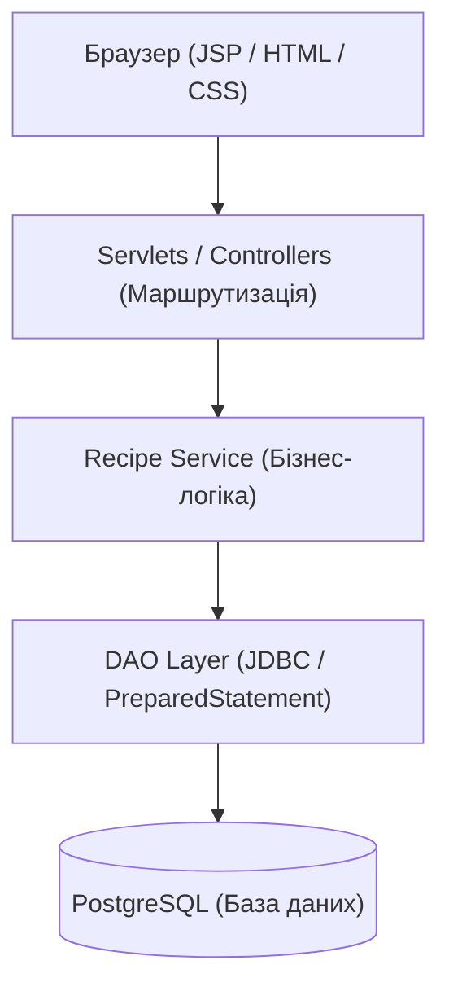
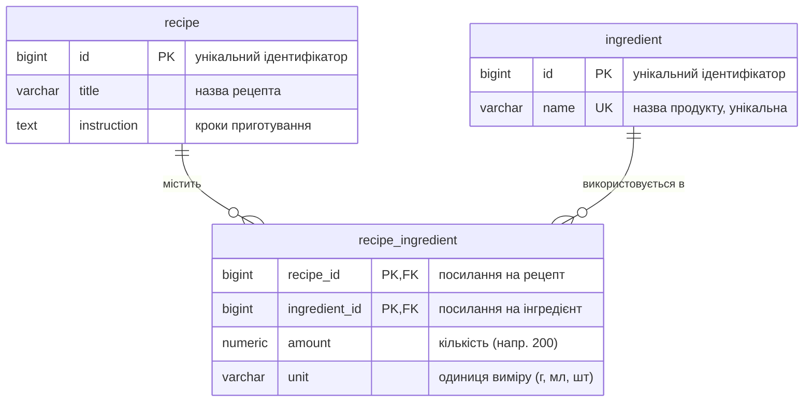
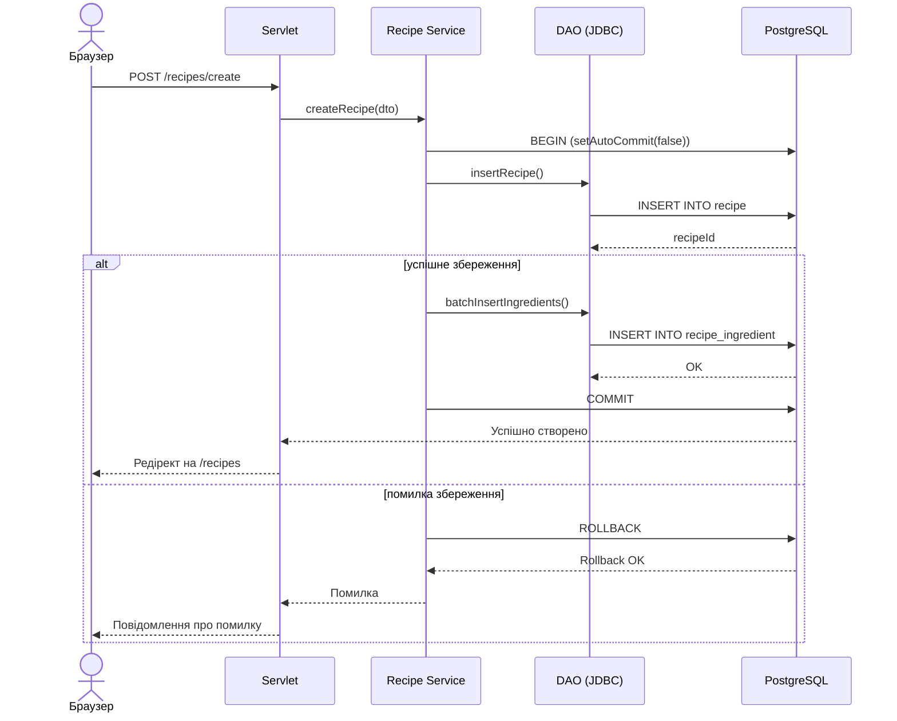
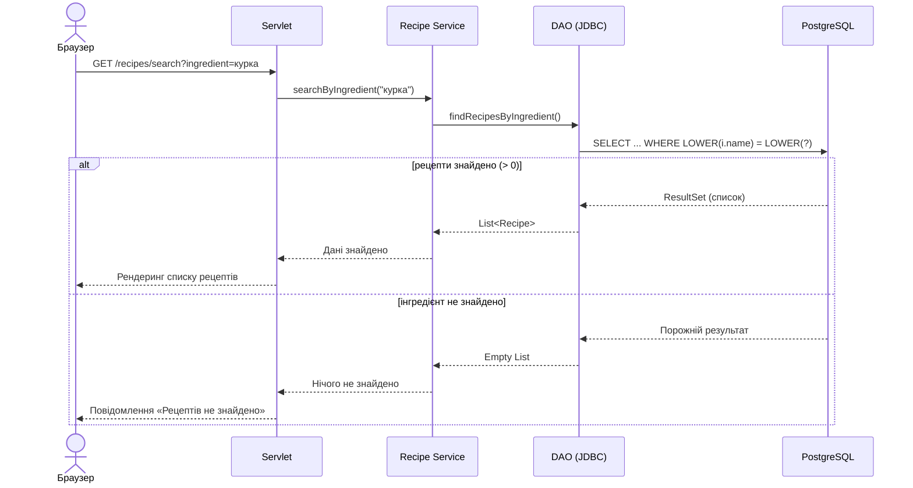

# SDD: Менеджер рецептів

## 1. Огляд і глосарій

Система — вебзастосунок на Java (Servlets + JSP), що працює на Apache Tomcat і зберігає кулінарні рецепти в PostgreSQL через JDBC. Для кожного рецепта зберігаються назва, список інгредієнтів із кількістю та одиницею виміру й інструкція приготування. Головна можливість — пошук рецептів за інгредієнтом («курка»). Перша версія розрахована на одного користувача, який веде свою колекцію рецептів: акаунтів немає, колекція одна. Підтримка багатьох користувачів з приватними колекціями запланована на версію 2

**Поза скоупом першої версії:** акаунти, авторизація та приватні колекції; мобільний застосунок (лише вебсторінки); фото рецептів; категорії; розрахунок калорійності; пошук за кількома інгредієнтами одночасно

**Глосарій:**

| Термін | Значення в цьому документі                                                                                                                                                 |
|--------|----------------------------------------------------------------------------------------------------------------------------------------------------------------------------|
| Користувач | Єдина людина, яка в в1 користується системою. Акаунтів і ролей немає. У версії 2 з'являться кілька користувачів з окремими колекціями                                      |
| Рецепт | Запис у таблиці `recipe`: назва та інструкція приготування. Сам по собі не містить інгредієнтів: вони зберігаються окремо                                                  |
| Інгредієнт | Довідниковий запис у таблиці `ingredient`: лише назва продукту (наприклад, «цибуля»). Назва унікальна, один інгредієнт може використовуватись у багатьох рецептах          |
| Позиція рецепта | Запис у таблиці `recipe_ingredient`: зв'язує один рецепт з одним інгредієнтом і містить кількість та одиницю виміру («200 г»). Саме через позиції рецепт «має» інгредієнти |
| Одиниця виміру | Текстове позначення міри в позиції рецепта («г», «мл», «шт», «ст. л.»). У версії 1 це вільний текст, а не окрема таблиця                                                   |
| Пошук за інгредієнтом | Запит, що повертає всі рецепти, у яких є позиція з інгредієнтом із заданою назвою. Регістр не враховується («курка» = «Курка»)                                             |

## 2. Функціональні вимоги

| ID | User story | Пріоритет |
|---|---|---|
| US-1 | Як користувач, я хочу додати рецепт із назвою, списком інгредієнтів (з кількістю й одиницею виміру) та інструкцією приготування, щоб зберегти його в одному місці замість паперів і скриншотів. | Must |
| US-2 | Як користувач, я хочу бачити список усіх збережених рецептів, щоб швидко знайти потрібний. | Must |
| US-3 | Як користувач, я хочу відкрити сторінку рецепта з інгредієнтами й інструкцією, щоб приготувати страву, не шукаючи деталі деінде. | Must |
| US-4 | Як користувач, я хочу знайти рецепти за назвою інгредієнта, щоб зрозуміти, що можна приготувати з продуктів, які вже є вдома. | Must |
| US-5 | Як користувач, я хочу редагувати збережений рецепт, щоб виправити помилку або змінити пропорції. | Should |
| US-6 | Як користувач, я хочу видалити рецепт, щоб прибрати зайве з колекції. | Should |
| US-7 | Як користувач, я хочу шукати рецепти одразу за кількома інгредієнтами, щоб відфільтрувати страви під наявний набір продуктів. | Could |
| US-8 | Як користувач, я хочу мати власний акаунт і приватну колекцію, щоб інші не бачили й не змінювали мої рецепти. | Won't (this time) |

## 3. Нефункціональні вимоги

| ID    | Категорія        | Вимога (з метрикою) |
|-------|------------------|---------------------|
| NFR-1 | Продуктивність   | Пошук рецептів за інгредієнтом повертає результат за < 100 мс, коли в базі єдиного користувача зберігається 10 000 рецептів і 50 000 інгредієнтів у рецептах |
| NFR-2 | Цілісність даних | Рецепт зберігається цілком або не зберігається взагалі. Я 100 разів штучно перериваю додавання рецепта посередині й перевіряю, що в базі 0 рецептів без інгредієнтів і 0 інгредієнтів без рецепта. |
| NFR-3 | Безпека          | Усі запити до бази йдуть через `PreparedStatement`, тому текст із форми не може стати частиною SQL-команди. У коді 0 місць, де запит склеюється з тексту користувача. Тест із введенням `'; DROP TABLE recipe; --` не змінює дані |
| NFR-4 | Сумісність       | Веб-інтерфейс (JSP + HTML/CSS) коректно відображається та функціонує без критичних багів  |
| NFR-5 | Масштаб бази даних | Схема PostgreSQL містить необхідні індекси (зокрема регістронезалежний), що гарантує виконання пошуку в межах заданого часу |

## 4. Архітектура

**Компоненти:**

- **Браузер (JSP / HTML / CSS)** — клієнтська частина: відображає списки рецептів, детальні сторінки та форми, надсилаючи GET- і POST-запити на сервер
- **Servlets / Controllers** — вхідна точка бекенду: зчитує параметри HTTP-запитів, перевіряє вхідні дані, викликає сервісний шар та керує перенаправленнями (Redirect/Forward) на JSP-сторінки
- **Recipe Service** — бізнес-логіка системи: керує транзакціями (NFR-2), обробляє зв'язки між рецептами та інгредієнтами, виконує бізнес-операції створення, редагування і пошуку
- **DAO Layer (JDBC / PreparedStatement)** — шар доступу до даних: інкапсулює SQL-запити, гарантує захист від SQL-ін'єкцій (NFR-3)
- **PostgreSQL** — єдине реляційне сховище даних системи: зберігає таблиці рецептів, інгредієнтів та зв'язків із підтримкою індексів для швидкого пошуку (NFR-5)

## 5. Модель даних

Модель реалізує зв'язок «багато до багатьох» між recipe та ingredient через сполучну таблицю recipe_ingredient, що дозволяє одному інгредієнту входити до багатьох різних рецептів. Унікальне обмеження (UK) на поле name у довіднику інгредієнтів запобігає дублюванню однакових продуктів у базі. Складений первинний ключ (recipe_id, ingredient_id) гарантує, що той самий інгредієнт не може бути доданий до одного рецепта двічі.

## 6. Ключові сценарії

### 6.1. Додавання нового рецепта

Користувач заповнює форму створення рецепта в браузері (назва, інструкція, список інгредієнтів), після чого система атомарно зберігає дані в базі

Якщо на етапі збереження інгредієнтів чи зв'язків виникає помилка, транзакція скасовується через ROLLBACK

### 6.2. Пошук рецептів за інгредієнтом

Користувач вводить назву продукту (наприклад, «курка») у пошуковий рядок, щоб знайти всі відповідні страви

Завдяки використанню регістронезалежного порівняння (LOWER) та індексів у PostgreSQL, пошук виконується швидко навіть при великій кількості записів

## 7. Ескіз API

| Метод | Шлях | Призначення | Доступ |
|-------|------|-------------|--------|
| GET | `/recipes` | Перегляд списку всіх збережених рецептів (US-2) | публічний (єдиний користувач) |
| GET | `/recipes/{id}` | Перегляд детальної сторінки рецепта та інструкції (US-3) | публічний |
| POST | `/recipes` | Створення та збереження нового рецепта з інгредієнтами (US-1) | публічний |
| PUT | `/recipes/{id}` | Редагування існуючого рецепта та його пропорцій (US-5) | публічний |
| DELETE | `/recipes/{id}` | Видалення рецепта з колекції (US-6) | публічний |
| GET | `/recipes/search?ingredient=...` | Пошук рецептів за назвою інгредієнта (US-4) | публічний |

## 8. Ризики та альтернативи

**Ризики:**

| Ризик | Імовірність | Вплив | Як пом'якшуємо |
|-------|-------------|-------|----------------|
| Дублювання назв інгредієнтів із різним регістром (наприклад, «Курка» та «курка») | висока | Середній: розмиття статистики та ускладнення пошуку | Унікальне обмеження (`UK`) на `LOWER(name)` у базі даних та нормалізація вхідного рядка (ведення всіх назв до нижнього регістру) в бізнес-логіці Recipe Service. |
| Користувач випадково закриває сторінку під час введення великого рецепта з багатьма інгредієнтами | середня | Високий: втрата часу та негативний досвід | Збереження чорнових даних у локальному сховищі браузера (localStorage) через простий скрипт перед отправкою форми. |
| Продуктивність пошуку падає при зростанні бази до 10 000 рецептів | низька | Високий: порушення нефункціональної вимоги NFR-1 (< 100 мс) | Створення правильних B-Tree індексів на зовнішніх ключах і полях пошуку (`ingredient.name`) на етапі ініціалізації бази даних (NFR-5). |

**Розглянуті альтернативи:**

- **Зберігати інгредієнти одним текстом усередині таблиці рецептів (наприклад, полем `ingredients_text`):** відкинуто — це суттєво спростило б збереження, але унеможливило б повноцінний та точний пошук рецептів за конкретним інгредієнтом (`US-4`), оскільки довелося б шукати підстроки в текстовому полі.
- **Використання вбудованої бази даних (наприклад, H2 або SQLite) замість PostgreSQL:** відкинуто — хоча це спростило б розгортання проєкту, PostgreSQL була обрана для того, щоб гарантувати повну відповідність нефункціональним вимогам (зокрема швидкий пошук через індекси за вимогами `NFR-1` та стабільну роботу з транзакціями за `NFR-2`).
- **Створення окремої таблиці для одиниць виміру («г», «мл», «шт»):** відкинуто для першої версії — оскільки в першій ітерації одиниці виміру є вільним текстом у таблиці зв'язку, окрема довідкова таблиця лише ускладнила б інтерфейс додавання рецепта без реальної потреби для єдиного користувача.
