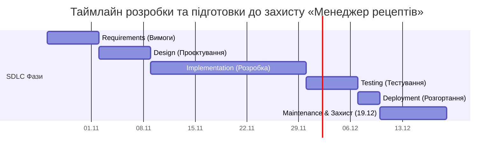

# SDLC: Менеджер рецептів

## 1. Ідея продукту

«Менеджер рецептів» — це вебзастосунок для структурованого збереження, організації та швидкого пошуку кулінарних рецептів. Застосунок дозволяє зберігати назву страви, покрокову інструкцію приготування та точний перелік інгредієнтів із їх кількістю та одиницями виміру. Основний фокус першої версії зроблено на зручному пошуку страв за наявними інгредієнтами, що дозволяє швидко обрати рецепт під продукти, які вже є вдома. Перша версія реалізована як персональний вебзастосунок без системи акаунтів та авторизації

**Цільова аудиторія:** люди, які регулярно готують вдома (студенти, кулінари-аматори, господарі/господині), ведуть власний кулінарний записник та шукають зручний інструмент для швидкого вибору страв

**Біль, який розв'язуємо:** зараз рецепти зберігаються розсіяно — у паперових блокнотах, нотатках телефону, закладках браузера або скріншотах. Через це складно швидко знайти потрібну страву, а також практично неможливо дізнатися, що можна приготувати з конкретного набору продуктів, який залишився в холодильнику, без ручного перегляду всіх записів

## 2. Обрана методологія

**Методологія:** Kanban

**Чому саме вона для цього продукту:**

Розробка виконується соло-розробником у форматі чітко визначеного навчального MVP із фіксованим скоупом (SDD). У такому контексті немає потреби в командних ритуалах Scrum (спринти, daily, ретроспективи), а вимоги до базик-функціоналу (додати рецепт, знайти за інгредієнтом) уже зафіксовані й не потребують постійних демо для зовнішнього замовника. Kanban дозволяє візуалізувати потік задач (через GitHub Projects board), гнучко керувати власним часом розробки та концентруватися на послідовному виконанні та тестуванні кожної окремої фічі без штучних часових обмежень спринту

**Чому не інші:**

- **Scrum:** вимагає наявності роли Product Owner для регулярного зворотного зв'язку, ітераційного планування та командних зустрічей. Для персонального проєкту одного розробника із заздалегідь продуманим SDD накладні витрати на Scrum-процеси є надлишковими
- **Waterfall:** занадто жорсткий каскадний підхід не дозволяє паралельно доопрацьовувати тесові сценарії чи робити невеликі рефакторинги коду за результатами розробки без повернення на початкову фазу

## 3. Фази життєвого циклу

### 3.1. Requirements (Вимоги)

| | |
|---|---|
| **Вхідні артефакти** | Ідея продукту (розділ 1 SDLC); власні кулінарні нотатки та опитування 2–3 знайомих, які готують вдома. |
| **Дії** | Аналіз існуючих способів збереження рецептів; формулювання User Stories; пріоритезація за MoSCoW; виділення вимог першої версії (без акаунтів і складної авторизації); визначення нефункціональних вимог (NFR). |
| **Вихідні артефакти** | Розділи 1–3 SDD (огляд продукту, User Stories з пріоритетами, вимірні NFR); беклог задач у GitHub Projects. |
| **Критерії виходу** | Усі Must-історії мають чіткі критерії прийняття (Acceptance Criteria); нефункціональні вимоги мають числові метрики (наприклад, NFR-1: час відповіді < 100 мс); беклог MVP сформовано. |

### 3.2. Design (Проєктування)

| | |
|---|---|
| **Вхідні артефакти** | Затверджені вимоги (розділи 1–3 SDD); беклог задач. |
| **Дії** |Проєктування реляційної моделі даних PostgreSQL (таблиці recipe, ingredient, recipe_ingredient); моделювання ER-діаграми; побудова Sequence diagrams для створення рецептів і пошуку за інгредієнтом; опис HTML/JSP форм і REST/HTTP API эндпоінтів; вибір стеку (Java 21, Servlets, JDBC, PostgreSQL, Apache Tomcat); аналіз ризиків і альтернатив. |
| **Вихідні артефакти** | Повний SDD (розділи 4–8: архітектура, ER-модель, Sequence-діаграми, API Sketch, ризики та альтернативи). |
| **Критерії виходу** | SDD повністю заповнений; кожна Must-історія покрита відповідним сервлетом, DAO-методом та SQL-запитом; схема бази даних пролічена й готова до ініціалізації SQL-скриптом. |

### 3.3. Implementation (Розробка)

| | |
|---|---|
| **Вхідні артефакти** | Повний SDD; SQL-скрипти створення схеми БД; беклог задач на Kanban-дошці.|
| **Дії** | Налаштування Maven-проєкту та Apache Tomcat; створення PostgreSQL DB Schema; написання JDBC DAO шару (RecipeDao, IngredientDao); реалізація сервісного шару та Java Servlets; верстка JSP/HTML сторінок із CSS; написання unit-тестів (JUnit 5 + Mockito) для бізнес-логіки. |
| **Вихідні артефакти** | Готовий вихідний код у гілці main; проходження комбінованих JUnit/Mockito тестів; локально працюючий WAR-архів або запуск під Tomcat. |
| **Критерії виходу** | Усі Must-функції (додавання рецепта, перегляд списку, деталі рецепта, пошук за інгредієнтом) реалізовані; покриття доменної логіки юніт-тестами $\ge 70\%$; код успішно збирається Maven. |

### 3.4. Testing (Тестування)

| | |
|---|---|
| **Вхідні артефакти** | Розгорнутий локально вебзастосунок з тестовою базой даних PostgreSQL; чекліст ручного тестування CRUD-операцій та пошуку. |
| **Дії** | Ручне тестування сценаріїв створення рецептів і пошуку; перевірка крайових випадків (пошук неіснуючого інгредієнта, відсутність чутливості до регістру, введення пустих полів); перевірка транзакційності при збереженні (NFR-2); виконання автоматичних JUnit/Mockito тестів. |
| **Вихідні артефакти** | Протокол ручного тестування та автоматичних прогонів; список виправлених дефектів. |
| **Критерії виходу** | 0 критичних помилок; пошук повертає коректні дані без урахування регістру; у разі помилки створення рецепта транзакція відкочується (ROLLBACK); усі тести JUnit проходять успішно. |

### 3.5. Deployment (Розгортання)

| | |
|---|---|
| **Вхідні артефакти** | Перевірений реліз-кандидат коду (WAR-архів/Maven build); фінальні DDL-скрипти БД; інструкція з розгортання (README). |
| **Дії** | Ініціалізація продуктивної бази даних PostgreSQL; деплой WAR-пакета на сервер додатка Apache Tomcat; перевірка змінних середовища для підключення до БД; виконання підтверджувального тесту (smoke test) на робочому середовищі. |
| **Вихідні артефакти** | Працюючий вебзастосунок; файл README.md з інструкцією локального або серверного запуску. |
| **Критерії виходу** | Застосунок відкривається у браузері; тестовий рецепт успішно створюється та шукається в продуктивній базі даних; процес запуску задокументований. |

### 3.6. Maintenance (Підтримка)

| | |
|---|---|
| **Вхідні артефакти** | Запущений у використання застосунок; інструкція запуску; канал для фідбеку або власні нотатки виявлених незручностей. |
| **Дії** | Моніторинг локальних логів Tomcat при помилках; оперативне виправлення багів через Kanban-дошку; оновлення залежностей у pom.xml; збір ідей для Версії 2 (категорії, фотографії, розрахунок калорійності, акаунти).|
| **Вихідні артефакти** | Патч-коміти у Git; поповнений беклог ідей для версії v2.0 (Could / Out of Scope). |
| **Критерії виходу** | Фаза є безстроковою; критичні баги виправляються в межах 24 годин; сформовано чіткий беклог вимог для другої версії застосунку. |

## 4. Definition of Done для продукту

- [ ] Усі Must-have User Stories із SDD (створення рецепта, перегляд детальної інформації, пошук за інгредієнтом) повністю реалізовані та працюють без критичних помилок
- [ ] Покриття доменної логіки юніт-тестами (JUnit 5 + Mockito) становить не менше 70%, і всі тести проходять успішно при збірці Maven.
- [ ] Нефункціональні вимоги (NFR) підтверджені вимірами: час відповіді сервера при пошуку рецептів становить < 100 мс, а помилки створення рецепта правильно відкочуються через БД-транзакцію (ROLLBACK).
- [ ] Наскрізний тестовий сценарій «додавання рецепта з інгредієнтами $\rightarrow$ знаходження його через пошук за інгредієнтом без урахування регістру» пройдено вручну в браузері.
- [ ] Документи SDD.md та SDLC.md повністю актуалізовані й відповідають реалізованій архітектурі та процесу розробки.

## 5. Таймлайн

## 6. Ролі та комунікація

**Команда:**

Проєкт розробляється в форматі **Solo-developer** (один розробник), тому всі ключові ролі суміщаються однією людиною:

| Роль | Зона відповідальності |
|------|-----------------------|
| Backend Developer | Проєктування та реалізація Java Servlets, JDBC DAO, PostgreSQL, верстка JSP-сторінок та HTML/CSS. |
| System Analyst | Формулювання вимог (SDD), проєктування ER-моделі даних, архітектурні рішення та розробка API Sketch. |
| QA Engineer | Покриття доменної логіки JUnit 5/Mockito тестами, ручне тестування CRUD-сценаріїв та перевірка NFR. |
| DevOps | Налаштування локального середовища Apache Tomcat, ініціалізація PostgreSQL та керування версіями у Git/GitHub. |

**Комунікація:**

- **Управління задачами та беклогом:** Задачі та фічі проєкту фіксуються та відстежуються на Kanban-дошці в **GitHub Projects** (колонки: *To Do*, *In Progress*, *Done*).
- **Синхронізація та рев'ю:** Оскільки розробка є індивідуальною, регулярні командні мітинги відсутні. Прогрес фіксується через  коміти в Git з описовими повідомленнями .
- **Артефакти та рішення:** Усі ключові технічні рішення фіксуються в документах `SDD.md` та `SDLC.md` у корені Git-репозиторію. Зміни вимог внесені після аналізу фіксуються безпосередньо в SDD.
